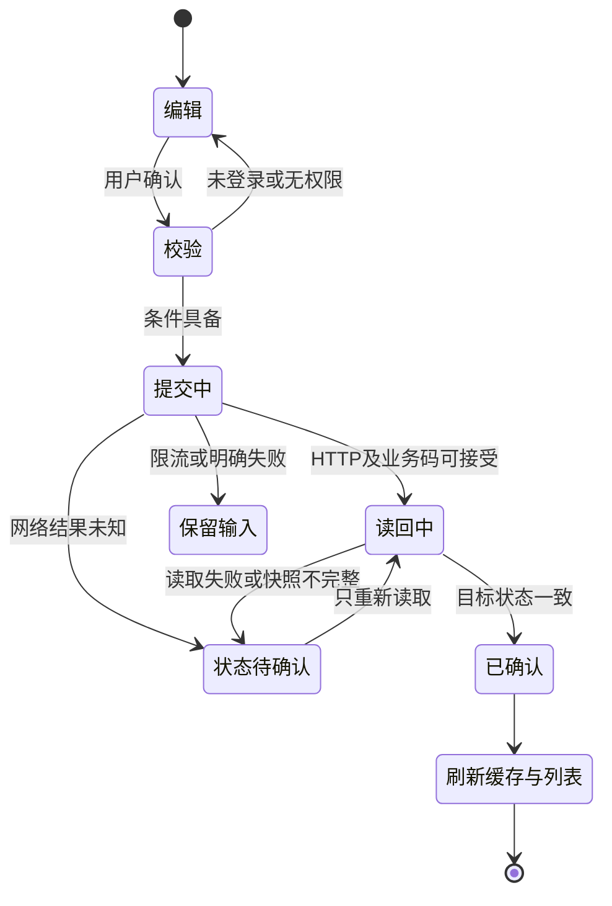

# 歌单交互与播放闭环提案

2026-10-28。当前范围经负责人确认：先完成方案与只读核查，暂不写账号数据。本轮不修改安卓生产界面、不调用歌单写接口。下列是待确认的产品行为，不是既有实现说明。

## 对象边界

- 歌单：云端长期保存的曲目集合、顺序和元数据。
- 播放队列：本次播放的本地快照，含当前歌曲、模式与临时插播。歌单编辑不偷偷改写正在播放的队列；移除队列项也不删除云端歌曲。
- 红心：我喜欢的音乐；歌曲菜单独立提供「添加到歌单」，不把红心当作普通歌单选择器。
- 自建普通歌单：可进入管理；收藏的他人歌单：浏览/播放，未来另接订阅与退订；特殊歌单：沿用专门行为，不出现普通删除/改隐私按钮。

## 入口与内容

| 入口 | 操作 | 反馈与回路 |
|---|---|---|
| 音乐库 → 歌单 | 自建/收藏分组，新建入口位于自建组 | 登录失效时保留内容并提供重新登录，不显示空歌单冒充读取成功 |
| 新建 | 输入名称、公开/私密，创建 | 成功读回后打开详情；失败保留输入，不自动重试创建 |
| 任意歌曲菜单 | 添加到歌单 → 仅列本人普通歌单 | 可新建后加入；已完整确认存在的歌曲显示「已在歌单」，不重复写入 |
| 歌单详情 | 封面、名称、简介、隐私、歌曲数、播放入口、曲目列表 | 有缓存先显示再刷新，未加载完整时说明，不冒充空内容 |
| 本人歌单 → 管理 | 名称、简介、隐私、选择曲目并移除、单个删除 | 不把多个字段当作原子事务；写入中防重复提交，取消不掩盖已提交结果 |
| 曲目多选 | 加入其他歌单 / 从当前歌单移除 | 明确「已完成/待确认/未处理」数量；取消只停止未发出的批次 |
| 删除歌单 | 显示歌单名与影响，再确认 | 云端删除不停止已经开始的播放快照；新建后加歌失败也不自动删除新歌单 |

窄屏采用歌单选择页或可展开的 Kanesumi 底部面板，避免把长歌单列表塞进很小的弹窗；宽屏沿用同一状态模型。选择器只加载可操作的本人歌单，但分页偏移仍按服务端请求步长推进，不按过滤后数量推进。

第一批不开放云端拖拽重排、封面上传、歌单文件夹和批量删除歌单；接口证据与冲突见 [歌单协议说明](../../spec/api/playlists.md)。本地查看排序如后续加入，必须标明不会改变云端顺序。

## 点歌行为：两种可审查选择

**推荐：歌单上下文。** 在歌单 `[A,B,C]` 中点 B，建立整张歌单的播放快照，当前索引为 B：列表循环时下一首 C，再下一首 A；上一首可回 A。先完成必要加载，成功后一次性替换，不能先清掉旧队列再等网络。

**保守替代：保持现有单曲插播。** 当前队列 `[X,Y]` 播 X，点 B 后变为 `[X,B,Y]`，当前为 B；只有点「播放歌单」才替换全队列。现有安卓详情页实际采用这一行为：`PlaylistDetailScreen.onSongClick` 最终调用 `MainScreen.playSongItem`。

本轮的可点击示意提供两种行为供比较，未更改现有手势。两者共同保留明确的「下一首播放」「追加到队尾」动作；这两个动作不替换整张队列、不改变循环模式，也不发云端歌单写请求。

交互提案源码位于 `preview/interaction.html`，仅使用 A/B/C/X/Y 示意数据，所有添加/移除反馈为本地模拟。它不是已接入安卓的页面，也不是后端接口成功的证据。

## 怎么循环

循环属于本地播放器，不需要歌单循环接口。云端只提供歌单快照和播放 URL，具体播放模式由 Ncrust 队列决定。以下均以自然结束为触发；手动「下一首」单独定义。

| 模式 | 自然播完当前曲 | 到尾部 | 手动下一首（提案） |
|---|---|---|---|
| 列表循环 CYCLE | 依原始歌单顺序推进 | 回到第一首；单首歌单重新播放该曲 | 推进并允许回绕 |
| 单曲循环 SINGLE | 重播当前曲 | 仍为当前曲 | 切到列表下一首，保留单曲循环模式 |
| 随机 SHUFFLE | 按本轮打乱表推进 | 新一轮排列；多曲时避免把刚播放的歌紧接着再播 | 走同一乱序游标 |
| 顺序一次 LINE | 依序推进 | 停在真实末曲，不把界面索引伪装成第一首 | 队尾停留，可显式重新播放 |
| 无限续播 INFINITY | 已有下一项时依序推进 | 明确选择后才拉相似歌曲，追加并去重 | 需要等待续播结果；失败不冒充列表循环 |

普通歌单首次播放默认 CYCLE；若后续记住模式，记录最近的普通播放模式，不把私人 FM 的标记和 INFINITY 自动带进普通歌单。具体模式在播放器中持续可见，不能用「播放」按钮暗中开启无限推荐。

所有队列操作保持 `queue[currentIndex].id == 实际播放歌曲 ID`。点击 B 应保留 `[A,B,C]` 的原始次序与索引 1，不能旋转成 `[B,C,A]` 再说是原歌单顺序。临时插播只修改本地快照；重新点播放歌单才按最新云端快照重建。

试听、无版权和音质降档继续复用既有权益规则；无可播放 URL 时有界跳过。整队不可播不能递归无限跳过。URL 失效时重新取 URL，不能误认为歌单已被删除。

### 现有实现需要先对齐的地方

`PlaybackQueueLogic.nextIndex` 已区分五种模式，可作为提案实现的基础，但不能据此宣布播放器行为完全符合上表：

- `playNext()` 当前在 SINGLE 下只 seekTo(0)，没有区分自然结束和用户下一首；提案要求区分触发原因。
- LINE 队尾分支当前回写首曲索引并暂停，而播放器停在末曲；这会破坏身份一致性，须先修再宣称歌单顺序一次可用。
- `replaceQueueAndPlay` 沿用全局 playMode，仅清 fmMode；需显式处理从 FM 转入普通歌单的模式。
- 预载在随机队尾按旧打乱表回绕，手动队尾会生成新排列；两条路径应由同一轮次状态决定下一项，不能各算一份。
- 当前完整歌单拉取会把补拉不到的曲目略去。新的播放快照应记录缺失状态与加载结果，不把不完整详情写成云端删歌。

本轮记录这些差距，未修改播放器代码或现有测试。

## 操作如何形成闭环

添加多首时，502 只能说明存在重复，不能说整批已完成；完整读回后分别确认每个目标 ID。成功提示、计数、列表和详情共同来自确认结果。部分成功保留具体操作记录，不做有风险的全量重试。

读回中的页面可以离开；写操作由账号绑定的应用级任务持有。若退出登录或切换账号，旧请求结果只能回到旧账号任务，不能刷新新账号列表。进程中断后先读取核对，不重放不确定的创建/删除操作。

## 接入顺序与验收

1. P0：确定点歌上下文选项；修齐队列触发原因、末曲身份与随机轮次，完善快照与操作结果模型。
2. P1：统一「添加到歌单」选择器及新建后添加，先有专用测试歌单的真实写后读回证据再开放。
3. P2：自建/收藏分组、元数据编辑、曲目移除与单个删除确认；全八语言和窄宽布局验收。

验收同时覆盖：从 B 开始的 C→A 循环、单曲自然结束与手动下一首差异、随机一轮无重复、LINE 留在末曲、从 FM 转入普通歌单、云端编辑不打断本地快照，以及 301/405/502、部分成功、读回失败、切账号与重启的恢复。当前没有账号写入授权，P1/P2 的真实写验证不在本轮范围。

## 本轮验证

- 只读探针：公开样本 7 次请求，全部 HTTP 200、业务码 200；4 项离线边界与完整性测试通过。
- 交互提案：16 项浏览器检查通过，脚本异常 0、账号 API 请求 0；[结果摘要](evidence/interaction-check-2026-10-28.json)。这些检查只覆盖示意模型。
- 320/360/736px、深浅两主题均无横向溢出；生成六张截图，已人工检查窄屏浅色与宽屏深色。主操作按钮文字对比度浅色 5.69:1、深色 5.71:1。截图在本地 `build/playlist-research/proposal-<宽度>-<主题>.png`。
- 复现：用安装的 visualize 技能 `scripts/render.py` 将 `docs/playlists/preview/interaction.html` 包装为 `build/playlist-research/preview.html`，再在仓库根运行 `node docs/playlists/preview/check-interaction.mjs`。需要已有的 playwright-core 和 Chromium；可用 `PLAYWRIGHT_MODULE` 指定模块入口、`PLAYWRIGHT_CHROMIUM_EXECUTABLE` 指定浏览器路径，不向产品添加依赖。
- 安卓生产代码未修改，本轮未运行 Gradle 构建或真实设备测试；没有将播放器差距和账号写入验证标记为完成。
